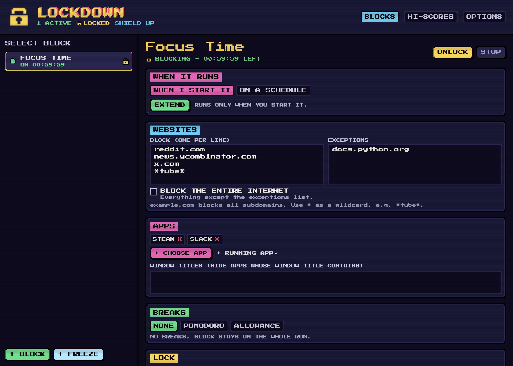
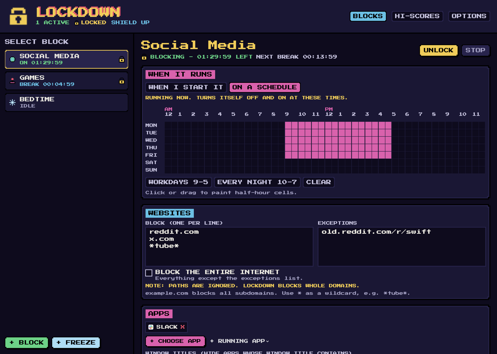
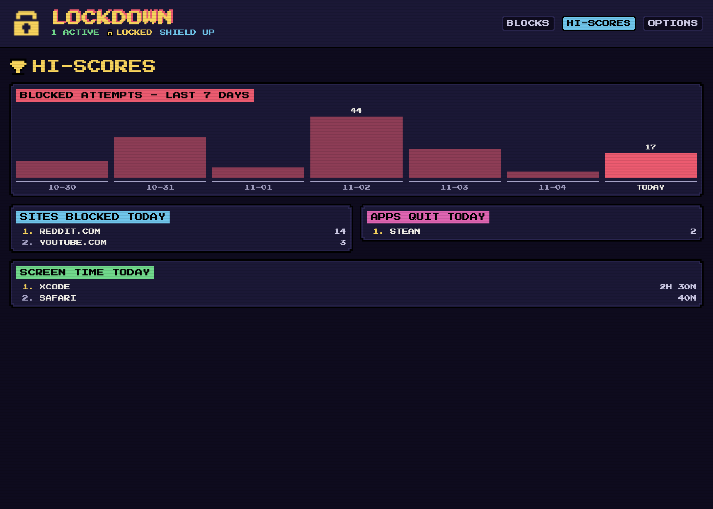
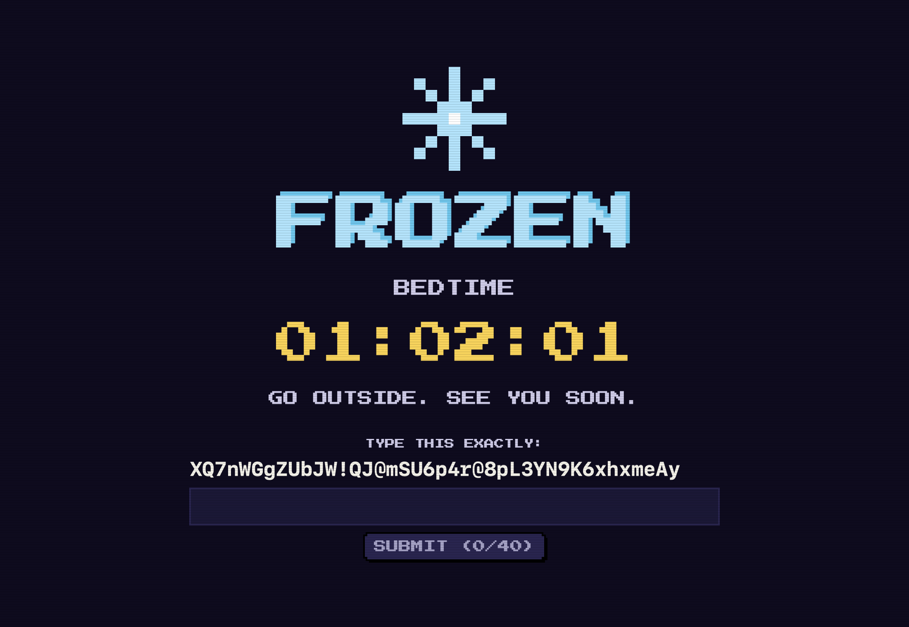
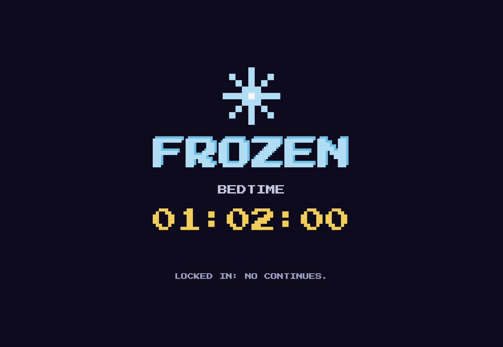
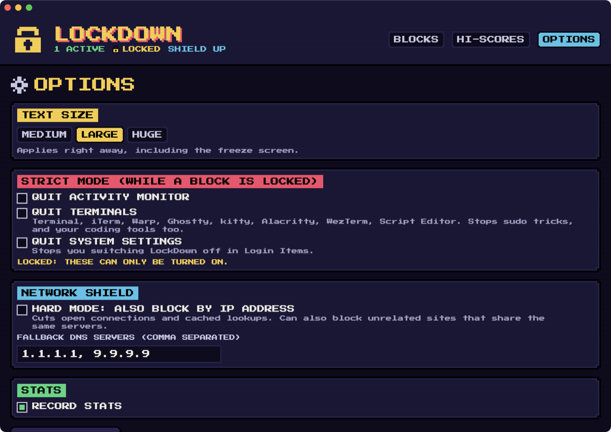

# LockDown

An 8-bit-styled website and app blocker for macOS, built as a replacement for Cold Turkey.
Blocking is system-wide, with no browser extensions and no paid Apple Developer account.

## Screenshots

A website and app block running:



| Blocks: schedule, Pomodoro breaks, random-text lock | Hi-scores |
|---|---|
|  |  |

| Freeze (random-text unlock) | Freeze (locked in) |
|---|---|
|  |  |



All screenshots except Options use sample data from `LockDown --render-preview <dir>`.

## How it works

| Piece | Runs as | Job |
|---|---|---|
| `lockdownd` | root (LaunchDaemon) | Owns blocks and lock state, runs a DNS blocker on `127.0.0.1:53`, loads pf firewall rules, re-applies them if removed |
| `LockDown --agent` | you (LaunchAgent) | Quits blocked apps, hides windows by title, shows the freeze screen, reports screen time |
| `LockDown.app` | you | The UI; talks to the daemon over `/var/run/lockdownd.sock` |

**Web blocking.** While a block with websites is running, every network service's DNS points at
LockDown. Blocked names resolve to `0.0.0.0` / `::`. A pf anchor (`com.apple/250.LockDown`, so
`/etc/pf.conf` is untouched) blocks outbound DNS/DoT to anything else, blocks known DNS-over-HTTPS
resolvers, and lets only the daemon's privileged source port (707) reach upstream DNS. The daemon
also returns NXDOMAIN for Firefox's DoH canary and iCloud Private Relay. With "hard mode" it also
firewalls the blocked sites' IP addresses and drops open connections to them.

**Locks.** Timer, random text (typed, no paste), password (PBKDF2 hash only), restart, plus
"lock schedule outside hours". A locked block can only be made stricter. Time comes from a
monotonic clock anchored to NTP, so changing the system clock doesn't end a block. If the daemon
is stopped while a locked web block runs, it leaves DNS redirected (fails closed).

**Breaks.** Pomodoro cycles, or a daily allowance spent on demand.

**When a block runs.** Each block runs one of two ways: when you start it, or by itself at the hours painted on its weekly schedule. A scheduled block can't be started by hand.

**Freeze.** Full-screen lock, log out, or shut down for the duration. A freeze survives reboots, so there's an emergency exit in case the freeze screen ever breaks: restarting 3 times in a row (each within 10 minutes of the last boot) ends any running freeze, whatever its lock. Other blocks keep running.

## Limits

- Domain-level only; URL paths and keywords inside URLs can't be blocked.
- VPNs that bring their own DNS bypass it. Add the VPN app to a block's app list while locked.
- Anyone with admin rights and determination can remove a root service. Strict mode (quit
  Terminal / Activity Monitor / System Settings) makes that harder during a lock.

## Build & install

```sh
swift test                      # core rule tests
./scripts/build-app.sh          # -> dist/LockDown.app (ad-hoc signed)
sudo dist/LockDown.app/Contents/Resources/install.sh
```

Uninstall (refused while anything is locked):
`sudo /Applications/LockDown.app/Contents/Resources/uninstall.sh`

Logs: `/var/log/lockdownd.log`. State: `/Library/Application Support/LockDown/`.

`LockDown --render-preview <dir>` renders the main screens with sample data to PNGs.

## Credits

- Logo: padlock tile from [1-Bit Pack](https://www.kenney.nl/assets/1-bit-pack) by Kenney,
  CC0 1.0 (`Resources/LICENSE-Kenney-1BitPack.txt`). Credit not required; given with thanks.
- Font: Press Start 2P (SIL Open Font License, `Resources/OFL-PressStart2P.txt`).

## Distributing

`./scripts/package.sh` builds `dist/LockDown-<version>.dmg` (universal: Apple silicon + Intel,
macOS 14+). It holds `Install LockDown.pkg`, `Uninstall LockDown.command` and a READ ME. Bump
`CFBundleShortVersionString` in `Support/Info.plist` before each release.

Without a paid Apple Developer account the package can't be signed or notarized, so macOS warns
on first open. Recipients right-click the package and choose Open, or use System Settings >
Privacy & Security > Open Anyway. The installer asks for an admin password, then its
postinstall runs `install.sh` to set up the daemon and agent. Installing over an existing copy
upgrades it in place and keeps blocks, locks and stats.

## License

MIT. See `LICENSE`. The font and logo keep their own licenses, listed under Credits.
